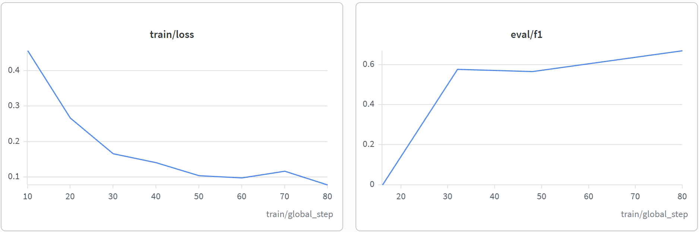
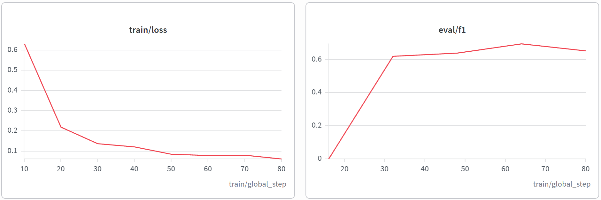

# Vietnamese Job Skill NER

[](https://www.python.org/)
[](https://pytorch.org/)
[](https://huggingface.co/docs/transformers)
[](https://onnxruntime.ai/)
[](LICENSE)

Fine-tune [vinai/phobert-base](https://huggingface.co/vinai/phobert-base) to extract **SKILL** entities from Vietnamese job-description and CV text (BIO tagging).

> **Status:** v1.0.0 — PhoBERT test F1 **0.6711** (54 sentences / 74 skill entities). CPU inference: PyTorch **35.39 ms** → ONNX Runtime **12.55 ms** (**2.82×**).
> **Weights:** [v1.0.0 release](https://github.com/phamthaic4/vietnamese-job-skill-ner/releases/tag/v1.0.0) — `model.onnx` · `model.safetensors` · `tokenizer.zip`.

## Problem

Recruiter tools need the skills a job post or CV actually mentions. This project trains a NER model to extract IT skills (Python, SQL, Docker, …) from mixed Vietnamese/English text.

The task is harder than it looks: Vietnamese job posts embed English technical terms inside Vietnamese syntax (`"có kinh nghiệm về Java Spring Boot"`), compound skills span several words (`Spring Boot`, `SQL Server`), symbol-heavy names get shredded by any whitespace tokenizer (`C/C++`, `CI/CD`, `.NET`), and ~30% of the skills in a held-out set are terms the model has never seen in training.

## Data

| Item | Value |
|------|-------|
| Source | IT job posts (TopCV, ITviec, VietnamWorks) + 5 CVs |
| Collected | 757 unique sentences (deduped) → 350 labeled after BIO validation |
| Size v1 | 350 labeled sentences, 372 skill mentions (186 unique) |
| Format | JSON: `{ "tokens": [...], "labels": [...] }` |
| Labels | `B-SKILL`, `I-SKILL`, `O` |
| Labeling | Manual BIO annotation in a spreadsheet; 97 label cells audited and fixed |
| QC | `scripts/validate_labels.py` — enforces that every `I-SKILL` follows a `B-SKILL` |
| Split | 244 train / 52 val / 54 test (seed 42) |

```
Token:   Tuyển   Python  developer  có  kinh nghiệm  SQL
Label:   O       B-SKILL O          O   O           B-SKILL
```

## Method

- Model: `vinai/phobert-base` (locked after ablation vs `xlm-roberta-base`)
- Task: token classification, BIO
- Subword label alignment for PhoBERT’s slow tokenizer
- Metrics: entity-level Precision / Recall / F1 (`seqeval`)
- Inference: `src/predict.py` with post-processing (glue `C/C++`, `CI/CD`; merge adjacent `B-SKILL` spans)

## Results

Training runs are logged on [Weights & Biases](https://wandb.ai) — loss and eval curves are embedded below. All numbers below are **entity-level** metrics (`seqeval`) on the frozen test split — **54 sentences / 74 skill entities**. Decision metric is **test F1**: the 52-sentence val set is too noisy to rank models reliably.

| Experiment | Model | LR | Epochs | Batch | P | R | **Test F1** | Notes |
|---|---|---|---|---|---|---|---|---|
| **exp_001** | `vinai/phobert-base` | **3e-5** | **5** | **16** | **0.6538** | **0.6892** | **0.6711** | Best checkpoint; val F1 0.6173 @ epoch 4 |
| exp_002 | `xlm-roberta-base` | 3e-5 | 5 | 8 | 0.6329 | 0.6757 | 0.6536 | Multilingual baseline; PhoBERT **+1.75% F1**, ~2.5× faster |
| exp_003 | `vinai/phobert-base` | 2e-5 | 5 | 16 | 0.5000 | 0.6892 | 0.5795 | Too-low LR: recall holds, precision collapses |
| exp_004 | `vinai/phobert-base` | 4e-5 | 5 | 16 | 0.5556 | 0.6757 | 0.6098 | Too-high LR: worse than 3e-5 |

**Locked config:** PhoBERT-base, LR `3e-5`, batch 16, 5 epochs.

### Training curves

PhoBERT (exp_001) — loss falls steadily and val F1 is still rising at the last epoch:



XLM-R (exp_002) — val F1 peaks around epoch 4 then drifts down (over-fitting), while its test F1 still lands below PhoBERT's:



### CPU latency (batch 1, local)

| Runtime | Mean latency | Notes |
|---|---|---|
| PyTorch `model/best` | 35.39 ms | torch CPU |
| ONNX Runtime `model/best/model.onnx` | 12.55 ms | opset 14 |

Same weights, **2.82×** faster. Re-run: `python scripts/export_onnx.py`.

### OOV robustness (test set)

| Group | Exact-match recall |
|---|---|
| In-vocab (52 / 74) | 71.2% |
| OOV (22 / 74) | 54.5% (−16.6%) |

Half of false negatives (5/10) are OOV skills — matches EDA (31.8% OOV unique skills). Full breakdown: [docs/error_analysis.md](docs/error_analysis.md).

## Quick start

```bash
pip install -r requirements.txt
```

### Model weights

Weights are **not** in git (the checkpoint is ~513 MB). Download them from the [v1.0.0 release](https://github.com/phamthaic4/vietnamese-job-skill-ner/releases/tag/v1.0.0):

| File | Size | Use |
|---|---|---|
| [`model.onnx`](https://github.com/phamthaic4/vietnamese-job-skill-ner/releases/download/v1.0.0/model.onnx) | 513 MB | ONNX Runtime inference — 12.55 ms CPU |
| [`model.safetensors`](https://github.com/phamthaic4/vietnamese-job-skill-ner/releases/download/v1.0.0/model.safetensors) | 513 MB | `transformers` / `from_pretrained()` |
| [`tokenizer.zip`](https://github.com/phamthaic4/vietnamese-job-skill-ner/releases/download/v1.0.0/tokenizer.zip) | 0.8 MB | `config.json` + `vocab.txt` + `bpe.codes` + `tokenizer_config.json` + `added_tokens.json` |

Put all three in `model/best/` (extract `tokenizer.zip` in place):

```bash
mkdir -p model/best
# move model.onnx, model.safetensors, tokenizer.zip into model/best/
unzip tokenizer.zip -d model/best/
```

Or load the checkpoint straight into `transformers`:

```python
from transformers import AutoTokenizer, AutoModelForTokenClassification

tokenizer = AutoTokenizer.from_pretrained("model/best")
model = AutoModelForTokenClassification.from_pretrained("model/best")
```

Then run:

```bash
python src/predict.py --text "Thành thạo ít nhất 1 ngôn ngữ Backend: Ưu tiên Python, Go, C/C++ hoặc Java (Spring Boot). Có kinh nghiệm làm việc với hệ quản trị cơ sở dữ liệu PostgreSQL, MySQL, Redis và triển khai Docker, Kubernetes, CI/CD."
```

```
KỸ NĂNG TRÍCH XUẤT ĐƯỢC (11 skills):
  1. Python
  2. Go
  3. C/C++
  4. Java
  5. Spring Boot
  6. PostgreSQL
  7. MySQL
  8. Redis
  9. Docker
  10. Kubernetes
  11. CI/CD
```

11/11, including the compound and symbol-heavy skills (`C/C++`, `Spring Boot`, `CI/CD`) that a naive tokenizer splits apart.

Full guide: [docs/reproduce.md](docs/reproduce.md).

Train from the frozen splits (Colab GPU recommended):

```bash
python src/train.py --smoke          # CPU smoke: alignment only
python src/train.py                  # full fine-tune → model/best
```

Export ONNX + benchmark:

```bash
python scripts/export_onnx.py
```

## Reproduce

| Step | Command / location |
|---|---|
| Labeled data | `data/splits/{train,val,test}.json` (frozen, seed 42) |
| Train | `python src/train.py` — PhoBERT, LR 3e-5, batch 16, 5 epochs |
| Weights | [v1.0.0 release](https://github.com/phamthaic4/vietnamese-job-skill-ner/releases/tag/v1.0.0) → extract into `model/best/` |
| Predict | `python src/predict.py --text "..."` |
| Error analysis | `python scripts/error_analysis.py` |
| ONNX | `python scripts/export_onnx.py` |
| Build log | [PROGRESS.md](PROGRESS.md) — week-by-week decisions and lessons |

Details: [docs/reproduce.md](docs/reproduce.md).

## Repository

```
vietnamese-job-skill-ner/
├── data/
│   ├── raw/jds.txt        # 757 collected JD sentences
│   ├── labeled/           # labeling template + sentence index
│   └── splits/            # frozen train / val / test JSON (seed 42)
├── docs/                  # error analysis, skill vocab, reproduce, wandb screenshots
├── notebooks/             # 01_eda, 02_error_analysis
├── scripts/               # labeling, convert, error_analysis, export_onnx
├── src/train.py           # fine-tune
├── src/predict.py         # inference + post-processing
├── model/best/            # checkpoint (gitignored — download from the v1.0.0 release)
├── results/experiments.csv
├── PROGRESS.md            # week-by-week build log
└── requirements.txt
```

## Limitations

Scope of v1.0.0, stated plainly:

| Limitation | Impact |
|---|---|
| Small test set — 54 sentences / 74 entities | F1 carries a wide confidence interval; one split cannot separate close models |
| False positives are the largest error class (17 / 42 = 40.5%) | Generic tech nouns (`frontend`, `Apple`, `OOP`, `Blueprints`) get tagged as skills |
| OOV recall drops 16.6 points vs in-vocab | Newly coined tech terms are systematically under-detected |
| Single entity type (`SKILL`) | No role / experience-level / seniority entities yet |
| Post-processing rules are hand-written | `C/C++`, `CI/CD` glue rules are tuned by hand, not learned |
| No CRF or rule-only baseline | The value added by post-processing is not yet quantified against a learned decoder |

## Next steps

- **v2 data** — grow to 500+ labeled sentences, add negative samples to cut false positives, augment from `docs/skill_vocab.md`
- **Hybrid extraction** — NER (context signal) + dynamic skill dictionary (vocabulary signal), motivated directly by the OOV result
- **Baselines** — CRF and rule-only decoders, to quantify what post-processing actually buys
- **Project 2 — JobMatch** — FastAPI service over this model (`/extract-skills`), CV–JD skill gap analysis, Gemini-generated interview questions

## Related work

- [A practical method for occupational skills detection in Vietnamese job listings](https://arxiv.org/abs/2210.14607) (Tran et al., 2022) — argues that skill detection in Vietnamese job listings is better framed as **ranking** than as NER, and beats NER in scarce-data regimes. That finding is what motivates the hybrid direction in [Next steps](#next-steps).
- [vinai/phobert-base](https://huggingface.co/vinai/phobert-base) — the monolingual Vietnamese encoder this project fine-tunes.
